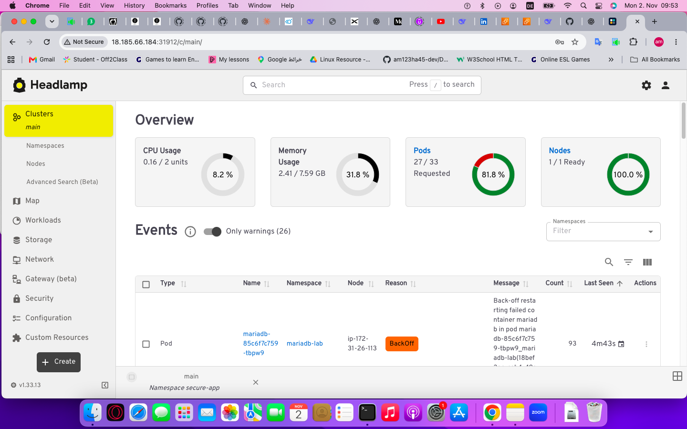
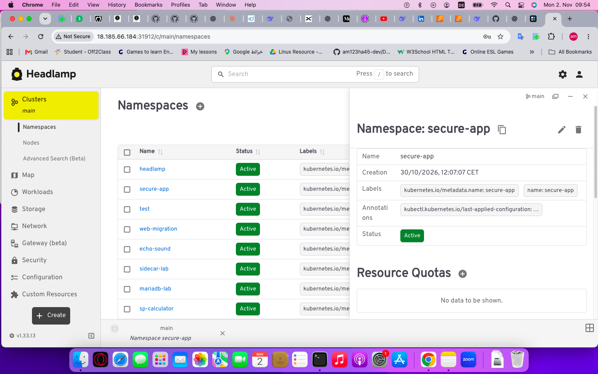
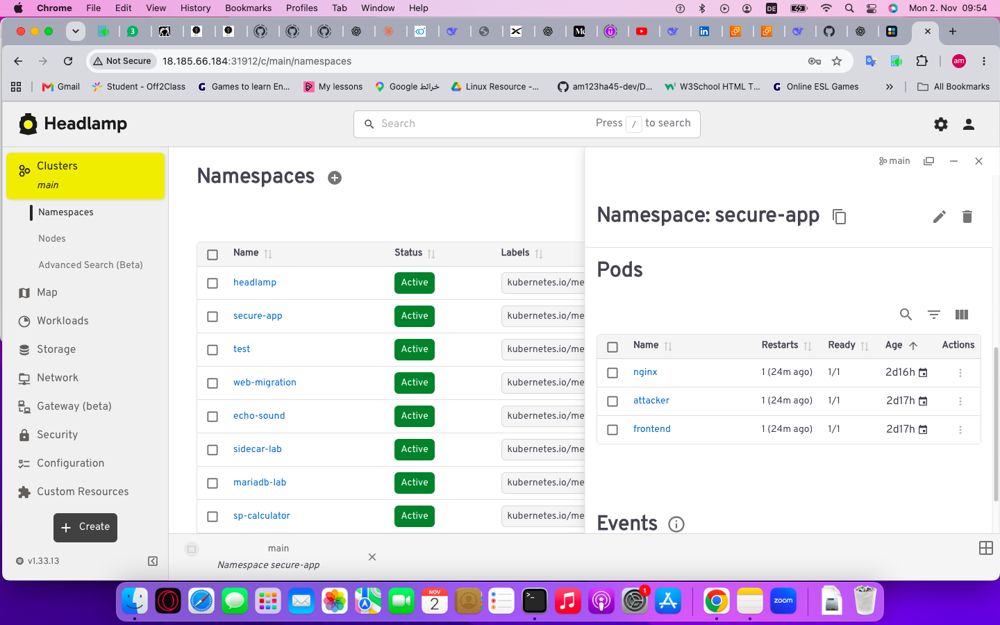
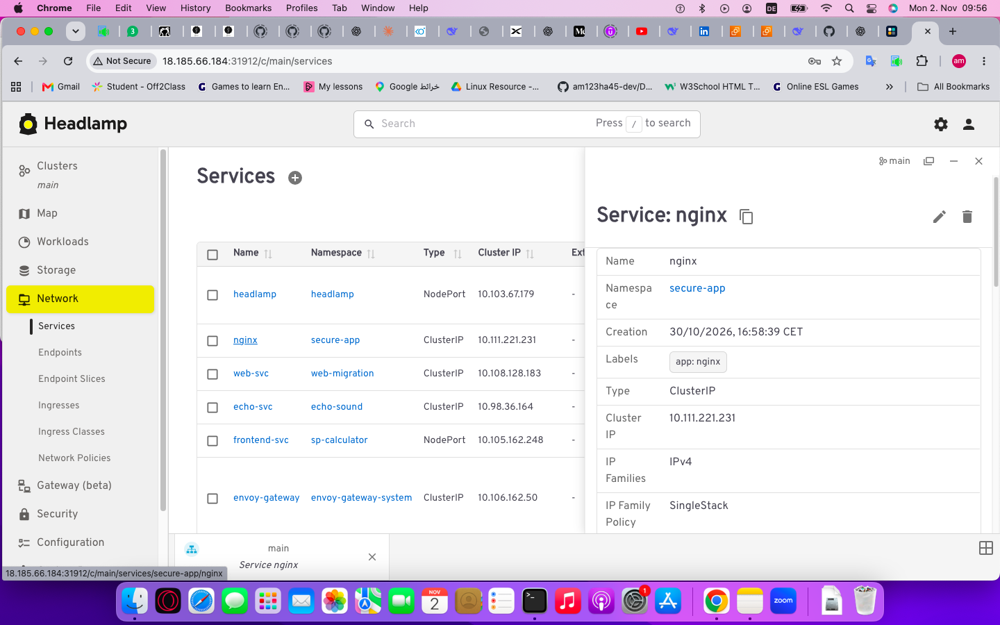
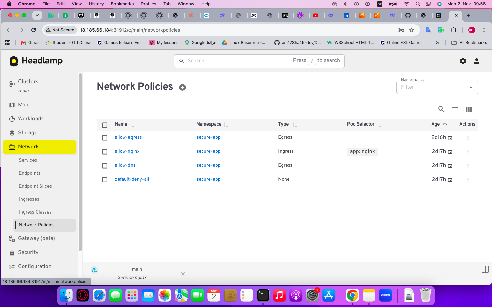

# 00 - Headlamp (Kubernetes UI)

## Objective
Deploy Headlamp — the official Kubernetes UI — for visual cluster management.

## Installation (Helm)

Add Helm repo:
    helm repo add headlamp https://kubernetes-sigs.github.io/headlamp/
    helm repo update

Create namespace:
    kubectl create namespace headlamp

Install:
    helm install headlamp headlamp/headlamp --namespace headlamp --set service.type=NodePort

Get NodePort:
    kubectl get svc -n headlamp

## Authentication

    kubectl create serviceaccount headlamp-admin -n headlamp
    kubectl create clusterrolebinding headlamp-admin-binding --clusterrole=cluster-admin --serviceaccount=headlamp:headlamp-admin
    kubectl create token headlamp-admin -n headlamp --duration=1h

Paste token in Headlamp UI → Authenticate.

## Screenshots

1. Cluster overview: 
2. Namespaces: 
3. Pods: 
4. Services: 
5. NetworkPolicies: 

## Access

http://18.185.66.184:31912

## What I Learned
- How to install Headlamp via Helm
- How to create a ServiceAccount + Token for authentication
- How to visualize Kubernetes resources
- How to inspect NetworkPolicies visually

