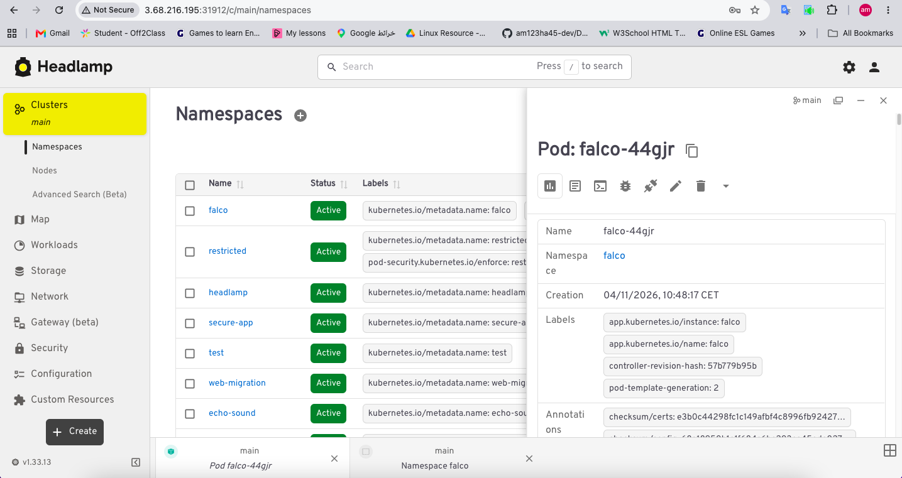
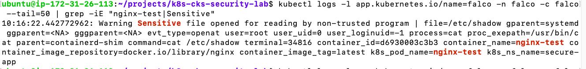

# 05 - Falco (Runtime Security)

## Objective
Deploy Falco to detect runtime threats (shell in container, sensitive file access, write to /etc).

## Installation

    helm repo add falcosecurity https://falcosecurity.github.io/charts
    helm repo update

    helm install falco falcosecurity/falco \
      --namespace falco \
      --create-namespace \
      --set tty=true

    kubectl get pods -n falco

## Test

### 1. Create nginx-test pod

    kubectl run nginx-test --image=nginx -n secure-app

### 2. Trigger rule (read /etc/shadow)

    kubectl exec -it nginx-test -n secure-app -- cat /etc/shadow

### 3. Check Falco logs

    kubectl logs -l app.kubernetes.io/name=falco -n falco -c falco --tail=50 | grep Warning

## Custom Rule

    customRules:
      custom-rules.yaml: |-
        - rule: Write below etc
          desc: An attempt to write to /etc directory
          condition: >
            (evt.type in (open,openat,openat2) and evt.is_open_write=true and fd.typechar='f' and fd.num>=0)
            and fd.name startswith /etc
          output: "File below /etc opened for writing | file=%fd.name"
          priority: WARNING

    helm upgrade falco falcosecurity/falco -n falco -f falco-custom-rules.yaml

## Screenshots

### Headlamp - Falco Pods

### Terminal - Falco Alert

## What I Learned
- How to deploy Falco on Kubernetes
- How to trigger runtime security rules
- How to write custom Falco rules
- How to verify Falco detection
