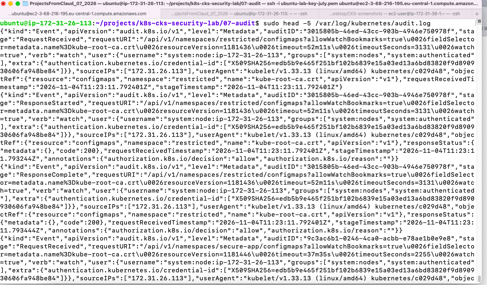

# 07 - Kubernetes Audit Logging

## Objective
Enable Kubernetes audit logging to track API requests (secrets, exec, etc.).

## Resources

| Resource | Purpose |
|----------|---------|
| `audit-policy.yaml` | Defines what to log (Metadata, Request, RequestResponse) |
| `/etc/kubernetes/audit-policy.yaml` | Mounted into kube-apiserver |
| `/var/log/kubernetes/audit.log` | Log output |

## Installation

### 1. Create audit policy

    sudo cp audit-policy.yaml /etc/kubernetes/audit-policy.yaml

### 2. Modify kube-apiserver manifest

    sudo nano /etc/kubernetes/manifests/kube-apiserver.yaml

Add:
- `--audit-policy-file=/etc/kubernetes/audit-policy.yaml`
- `--audit-log-path=/var/log/kubernetes/audit.log`
- `--audit-log-maxage=7`
- `--audit-log-maxbackup=3`
- `--audit-log-maxsize=100`

Add volume mounts + volumes.

### 3. Restart kube-apiserver

    sudo mv /etc/kubernetes/manifests/kube-apiserver.yaml /tmp/kube-apiserver.yaml
    sleep 5
    sudo mv /tmp/kube-apiserver.yaml /etc/kubernetes/manifests/kube-apiserver.yaml

### 4. Verify

    kubectl get pods -n kube-system | grep kube-apiserver
    sudo ls -la /var/log/kubernetes/

## Test

    # Create secret
    kubectl create secret generic test-audit -n secure-app --from-literal=key=value

    # Delete secret
    kubectl delete secret test-audit -n secure-app

    # Check audit log
    sudo tail -20 /var/log/kubernetes/audit.log

    # Filter secrets
    sudo cat /var/log/kubernetes/audit.log | grep '"resource":"secrets"' | tail -5

## Screenshots

### Terminal - Audit Log

## What I Learned
- How to create an audit policy
- How to enable audit logging on kube-apiserver
- How to verify audit logs
- How to filter audit logs for secrets
