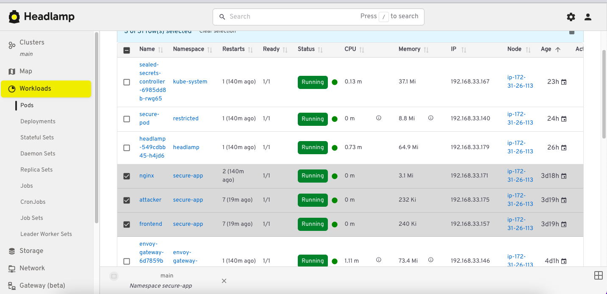

# 08 - Syft (SBOM)

## Objective

Generate a **Software Bill of Materials (SBOM)** for all images running in `secure-app` namespace using **Syft**.

The SBOM is a complete inventory of packages and libraries inside each image. It will be used by **Trivy (Step 06)** for fast vulnerability scanning without re-pulling images.

## Why SBOM?

- **Supply Chain Security**: Know exactly what's inside your images.
- **Compliance**: NTIA / EO 14028 requirements.
- **Fast Scanning**: Trivy can scan SBOM instead of images.
- **CVE Response**: When a new CVE is announced (e.g., Log4j), search your SBOMs to know if you're affected.

## Installation

    curl -sSfL https://raw.githubusercontent.com/anchore/syft/main/install.sh | sudo sh -s -- -b /usr/local/bin
    syft version

## Usage

### 1. Generate SBOM for a single image

    syft nginx:1.25-alpine -o cyclonedx-json=example-nginx-sbom.json

### 2. Generate SBOM for all images in secure-app

    IMAGES=$(kubectl get pods -n secure-app -o jsonpath='{.items[*].spec.containers[*].image}' | tr ' ' '\n' | sort -u)
    for IMG in $IMAGES; do
      SAFE_NAME=$(echo "$IMG" | tr '/:' '_')
      syft "$IMG" -o cyclonedx-json="${SAFE_NAME}-sbom.json"
    done

### 3. Analyze SBOM

    # Count packages (requires jq)
    jq '.components | length' example-nginx-sbom.json

    # List packages (requires jq)
    jq -r '.components[] | "\(.name) \(.version)"' example-nginx-sbom.json

    # Find specific package (requires jq)
    jq '.components[] | select(.name=="openssl")' example-nginx-sbom.json

### 4. Syft Kubernetes integration

    syft k8s:secure-app -o table

## Output format

We use **CycloneDX JSON** format (industry standard). It's compatible with:
- Trivy (Step 06)
- Grype
- Dependency-Track
- GitHub Dependency Graph

## Images Scanned

| Image | Packages | Executables |
|-------|----------|-------------|
| `alpine:3.19` | 15 | 17 |
| `nginx:1.25-alpine` | (see SBOM) | (see SBOM) |

## Screenshots

### Headlamp - SBOM

## What I Learned

- What an SBOM is and why it matters for supply chain security
- How to generate SBOMs with Syft in CycloneDX format
- How to analyze SBOM content with `jq`
- How to automate SBOM generation for all images in a namespace
- How SBOM integrates with Trivy for vulnerability scanning
