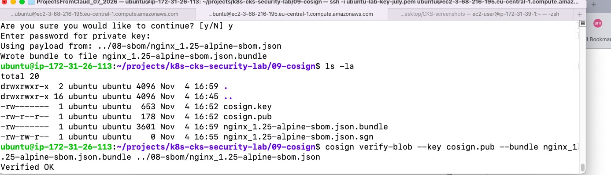

# 09 - Cosign (Image & Artifact Signing)

## Objective
Sign SBOM files with Cosign to ensure integrity and provenance.

## Installation

    wget https://github.com/sigstore/cosign/releases/latest/download/cosign-linux-amd64
    sudo install -m 755 cosign-linux-amd64 /usr/local/bin/cosign
    cosign version

## Generate Key Pair

    cosign generate-key-pair

This creates:
- `cosign.key` (private key) — DO NOT COMMIT
- `cosign.pub` (public key) — safe to commit

## Sign SBOM (Cosign v3+)

    cosign sign-blob --key cosign.key \
      --bundle nginx_1.25-alpine-sbom.json.bundle \
      ../08-sbom/nginx_1.25-alpine-sbom.json

## Verify

    cosign verify-blob --key cosign.pub \
      --bundle nginx_1.25-alpine-sbom.json.bundle \
      ../08-sbom/nginx_1.25-alpine-sbom.json

Expected output: `Verified OK`

## Screenshots

### Terminal - Cosign Verify

## What I Learned
- How to install Cosign
- How to generate a key pair
- How to sign a blob (SBOM) with `--bundle`
- How to verify a signature
- How to keep private keys safe
