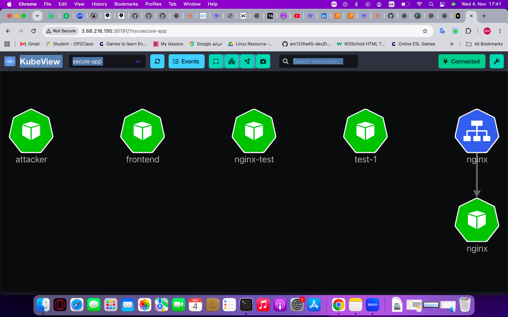
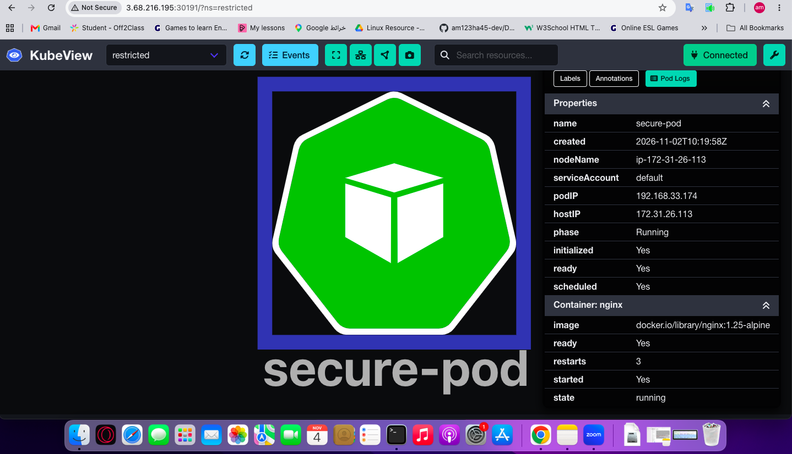

# 10 - KubeView (Visual Cluster Map)

## Objective
Deploy KubeView to visualize cluster topology (pods, services, network policies, secrets).

## Installation

    helm repo add kubeview https://benc-uk.github.io/kubeview/charts
    helm repo update

    kubectl create namespace kubeview

    helm install my-kubeview kubeview/kubeview \
      --namespace kubeview \
      --set service.type=NodePort

    # If LoadBalancer (pending), patch to NodePort
    kubectl patch svc my-kubeview -n kubeview -p '{"spec":{"type":"NodePort"}}'

    kubectl get svc -n kubeview

## Access

    http://18.185.66.184:30191

## Screenshots

### secure-app namespace

### restricted namespace

## What I Learned
- How to deploy KubeView via Helm
- How to expose a service via NodePort
- How to visualize cluster topology
- How to inspect NetworkPolicies visually
