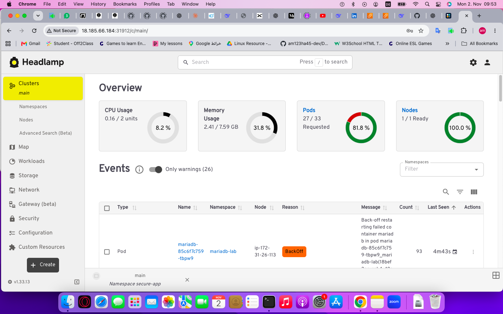

# Kubernetes CKS Security Lab

A hands-on lab demonstrating Certified Kubernetes Security Specialist (CKS) skills, built step-by-step with real tools.

## Skills Covered

| # | Skill | Tool | Status |
|---|-------|------|--------|
| 0 | Visual Cluster UI | Headlamp | Done |
| 1 | RBAC (Least Privilege) | Kubernetes Native | Done |
| 2 | Network Policies (Default Deny) | Kubernetes Native | Done |
| 3 | Pod Security Standards | Kubernetes Native | In Progress |
| 4 | Secrets Management | Sealed Secrets | Planned |
| 5 | Runtime Security | Falco | Planned |
| 6 | Vulnerability Scanning | Trivy | Planned |
| 7 | SBOM Generation | Syft | Planned |
| 8 | Image Signing | Cosign | Planned |
| 9 | Audit Logging | Kubernetes Audit | Planned |

## Repository Structure

    k8s-cks-security-lab/
    ├── 00-headlamp/
    ├── 01-rbac/
    ├── 02-network-policies/
    ├── 03-pod-security/
    ├── 04-secrets/
    ├── 05-falco/
    ├── 06-trivy/
    ├── 07-audit/
    ├── screenshots/
    ├── scripts/
    └── README.md

## Screenshots

## Quick Start

    git clone https://github.com/devops-job123/k8s-cks-security-lab.git
    cd k8s-cks-security-lab

## Author

Amer Al Hasheesh
- LinkedIn: linkedin.com/in/amer-al-hasheesh-319781327
- GitHub: github.com/devops-job123# k8s-cks-security-lab
Hands-on Kubernetes CKS security lab: RBAC, NetworkPolicies, Pod Security, Sealed Secrets, Falco, Trivy, Audit Logging
